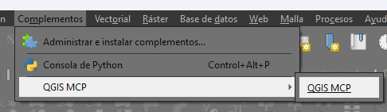
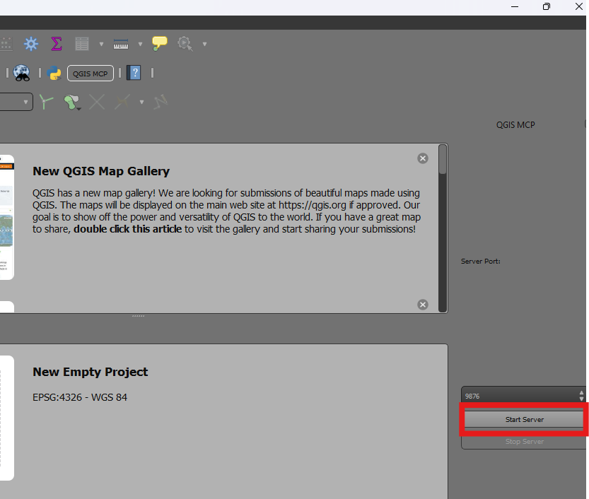
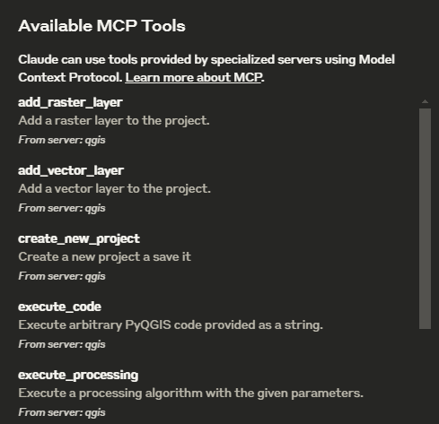

# QGIS MCP

QGIS MCP connects an MCP client to QGIS through a plugin and a Python server. It supports project, layer, feature, map-rendering, and Processing workflows.

## Requirements

- QGIS 3.x (tested with QGIS 3.22)
- Python 3.12 or newer
- [uv](https://docs.astral.sh/uv/getting-started/installation/)
- An MCP-compatible client, such as Visual Studio Code or Claude Desktop

The plugin runs inside QGIS. The Python MCP server runs separately and communicates with it over localhost port 9876.

## Installation

1. Clone the repository and install dependencies:

   ```powershell
   git clone https://github.com/aptana/QGIS-MCP.git
   cd QGIS-MCP
   uv sync
   ```

2. In QGIS, open **Settings > User Profiles > Open Active Profile Folder**. Copy the repository's `qgis_mcp_plugin` folder into the profile's `python/plugins` directory, so the final path is `python/plugins/qgis_mcp_plugin`.

   Typical plugin directories:

   - Windows: `%APPDATA%/QGIS/QGIS3/profiles/default/python/plugins`
   - macOS: `~/Library/Application Support/QGIS/QGIS3/profiles/default/python/plugins`

3. Restart QGIS, open **Plugins > Manage and Install Plugins**, and enable **Q-MCP**. Then open **Plugins > QGIS MCP > QGIS MCP** and click **Start Server**.

   

   

## Configure an MCP Client

For Visual Studio Code, create or update `.vscode/mcp.json` in your workspace. Replace the directory with the absolute path to your local clone:

```json
{
  "servers": {
    "qgis": {
      "type": "stdio",
      "command": "uv",
      "args": [
        "--directory",
        "C:/path/to/QGIS-MCP",
        "run",
        "src/qgis_mcp/qgis_mcp_server.py"
      ]
    }
  }
}
```

For other MCP clients, use the same command and arguments in that client's server configuration. Make sure `uv` is on the client's PATH, or use the full path to `uv.exe`. Keep QGIS open and the plugin server running while using the tools.

## Available Tools

- `ping`, `get_qgis_info`
- `load_project`, `create_new_project`, `get_project_info`, `save_project`
- `add_vector_layer`, `add_raster_layer`, `get_layers`, `remove_layer`, `zoom_to_layer`
- `get_layer_features`, `export_layer_features_geojson`
- `execute_processing`, `render_map`, `execute_code`



## Usage and Safety

- Tool paths must be accessible on the machine running QGIS.
- `execute_processing` runs QGIS Processing algorithms with the supplied algorithm ID and parameters.
- `execute_code` runs arbitrary Python inside QGIS. Only use code you trust; it can access or modify anything available to QGIS.
- The plugin listens on `localhost:9876`. If it cannot start, check whether another process is using that port.

## Troubleshooting

- **Cannot connect:** Start the plugin server in QGIS before starting or restarting the MCP server in your client.
- **Plugin is missing:** Confirm `qgis_mcp_plugin` is inside the active profile's `python/plugins` directory, then restart QGIS and enable the plugin.
- **Dependency errors:** Run `uv sync` from the repository root and verify the client configuration points to this clone.
- **Port is unavailable:** Check for another process listening on port 9876.
